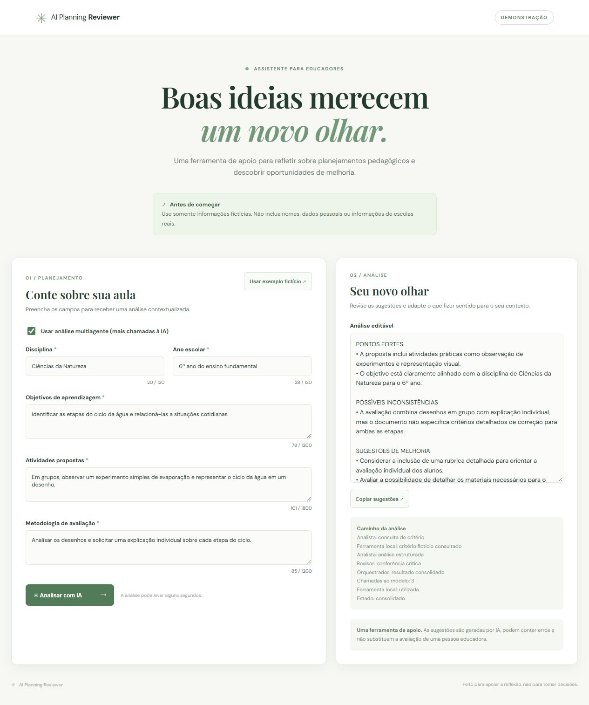
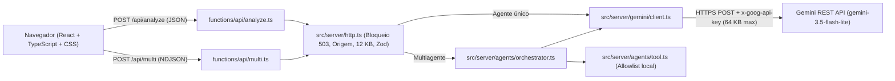

# AI Planning Reviewer V2

> **Aviso de escopo e uso responsável:** este é um **protótipo de estudo e portfólio em engenharia de aplicações com LLMs**, executado exclusivamente em ambiente local com **planejamentos pedagógicos fictícios**. As sugestões geradas por IA podem conter erros ou suposições não confirmadas, **não aprovam nem reprovam planejamentos**, **não substituem uma pessoa educadora** e **não são utilizadas em produção**. Nunca insira nomes, dados pessoais ou informações de escolas reais.

---

## 1. Problema e Objetivo

Planejamentos pedagógicos podem apresentar objetivos vagos, atividades pouco conectadas ao que se espera ensinar, avaliações desalinhadas ou lacunas práticas (como duração e critérios).

Eu criei o **AI Planning Reviewer** para explorar, de forma explícita e auditável, como construir uma aplicação web que integra um modelo de linguagem (Gemini) com:
- fronteira clara entre navegador e servidor;
- validação rigorosa de entrada e saída com **Zod** e **JSON Schema**;
- engenharia de prompts versionada;
- **function calling** restrito por allowlist local;
- **orquestração multiagente determinística** com teto rígido de chamadas;
- testes automatizados sem dependência de chave real nem cobrança;
- metodologia reproduzível de avaliação de LLMs.

Na **V2**, evoluí o protótipo original focando em qualidade de engenharia de IA generativa — sem adicionar frameworks de agentes (LangChain, LangGraph, CrewAI, AutoGen ou LlamaIndex) e sem aumentar complexidade artificialmente.

---

## 2. Demonstração

1. Preencha **disciplina**, **ano escolar**, **objetivos**, **atividades** e **avaliação** — ou clique em **Usar exemplo fictício** (ou em um dos casos fictícios adicionais: *Matemática — objetivos vagos* ou *Avaliação desalinhada*).
2. Escolha entre **Agente único** (1 chamada estruturada ao modelo) ou **Análise multiagente** (até 4 chamadas sequenciais com ferramenta local fictícia e revisor crítico, exibindo eventos reais em NDJSON).
3. Clique em **Analisar com IA**. Revise as seções estruturadas (*Pontos fortes*, *Possíveis inconsistências*, *Sugestões de melhoria* — e, no modo multiagente, *Fatos informados*, *Inferências e suposições*, *Ressalvas* e *Ferramenta consultada*), edite o texto na área editável e copie o resultado.

### Capturas históricas da V1 (chamadas reais locais em 13/11/2026)

As capturas abaixo foram preservadas integralmente da V1 e correspondem a **chamadas reais locais ao `gemini-3.5-flash-lite`** com dados fictícios (não houve deploy público):




Outras capturas preservadas da V1: [carregamento real](docs/imagens/02-carregamento.jpg), [resultado real agente único](docs/imagens/03-resultado-real.jpg) e [viewport mobile 390 px](docs/imagens/04-mobile.jpg).

> **Sobre capturas da interface V2:** não foram geradas capturas visuais de navegador para a interface atualizada V2 porque o ambiente desta auditoria não tinha Google Chrome em modo de depuração remota (`DevToolsActivePort` indisponível). Os novos componentes estruturados, metadados reais, estados de carregamento/cancelamento, edição/restauração e streaming NDJSON foram verificados pela suíte automatizada com Testing Library + JSDOM (`tests/ui-v2.test.tsx`).

---

## 3. Arquitetura



A chave `GEMINI_API_KEY` existe exclusivamente no ambiente do servidor (`functions/api/`), nunca no frontend. A arquitetura detalhada, incluindo diagramas Mermaid de agente único, multiagente, function calling e tratamento de falhas, está em [docs/ARCHITECTURE.md](docs/ARCHITECTURE.md) e [docs/LLM_INTEGRATION.md](docs/LLM_INTEGRATION.md).

---

## 4. Engenharia de Prompts

Os prompts são versionados e preservados integralmente:
- **Histórico preservado (`src/prompts/history.ts`):** `single-v1`, `single-v2`, `single-v3` e `multi-v1`, vinculados aos registros reais de 13/11/2026 em `prompt-lab/`.
- **Evolução V2 (`src/prompts/single.ts` e `src/prompts/agents.ts`):**
  - `single-v4` explicita a distinção entre *fato presente no planejamento*, *interpretação*, *sugestão*, *informação ausente* e *suposição não confirmada*, proibindo apresentar sugestões como fatos fornecidos pelo usuário.
  - `multi-v2` refina os papéis de Analista e Revisor Crítico, instruindo o revisor a **não concordar automaticamente** com o analista e a verificar fatos inventados, suposições não justificadas e sugestões genéricas.

Não afirmo superioridade empírica de `single-v4` ou `multi-v2` sobre a V1 porque novas chamadas reais ao Gemini aguardam autorização explícita de consumo. Detalhes em [docs/PROMPT_ENGINEERING.md](docs/PROMPT_ENGINEERING.md).

---

## 5. Sistema Multiagente e Function Calling

O modo multiagente usa **um único modelo base** (`gemini-3.5-flash-lite`) em dois papéis distintos coordenados por um **orquestrador determinístico** (`src/server/agents/orchestrator.ts`), com **teto rígido de 4 chamadas sequenciais** e **zero retries automáticos**:

1. **Chamada 1 — Analista + Function Calling (`mode: 'ANY'`):** o modelo escolhe um dos 4 temas permitidos (`objetivos`, `atividades`, `avaliacao`, `alinhamento`) e solicita `consultar_criterio_ficticio`. O servidor valida nome, `id` e argumentos em allowlist estrita (`src/server/agents/tool.ts`) e consulta critérios **locais e fictícios** (não são normas oficiais), sem acesso a arquivos, terminal ou rede.
2. **Chamada 2 — Analista (Análise Estruturada):** recebe o histórico original (preservando `id` e eventual `thoughtSignature`) + `functionResponse` e produz JSON validado por `analystSchema` (incluindo `fatosInformados` e `inferencias`).
3. **Chamada 3 — Revisor Crítico:** recebe `{ planejamento, analise }` em chamada independente e decide entre `CONSOLIDAR`, `REVISAR` ou `RESSALVAS`. Se o revisor falhar (sem cancelamento), a análise já validada é preservada com `estado: 'com_ressalvas'`.
4. **Chamada 4 (condicional) — Revisão única:** se o revisor escolher `REVISAR`, o analista reescreve uma única vez. Para respeitar o limite máximo de 4 chamadas, a versão revisada **não passa por nova reavaliação automática** e é marcada explicitamente como `revisado_sem_reavaliacao`.

Documentação completa em [docs/MULTIAGENT_ARCHITECTURE.md](docs/MULTIAGENT_ARCHITECTURE.md) e [docs/FUNCTION_CALLING.md](docs/FUNCTION_CALLING.md).

---

## 6. Respostas Estruturadas e Estratégia de Avaliação

- **Contratos Zod (`src/schemas/plan.ts`, `src/schemas/multi.ts`):** validam entrada do usuário, envelope do provedor, saída do analista, saída do revisor, argumentos da ferramenta, resultado final, eventos NDJSON e erros HTTP — rejeitando JSON malformado, strings vazias/só espaços, campos extras (`.strict()`) e limites excedidos, sem autocorreção silenciosa.
- **JSON válido ≠ conteúdo correto:** para avaliar qualidade real, criei em `experiments/` um protocolo reproduzível com **12 planejamentos fictícios** (`experiments/cases.json` — coerentes, vagos, desalinhados, incoerentes, incompletos, contraditórios, extensos e 4 vetores adversariais) e uma **rubrica humana de 8 dimensões** (`experiments/rubric.json`, escala 0–2, máximo 16 pontos).

Detalhes em [docs/EVALUATION_METHODOLOGY.md](docs/EVALUATION_METHODOLOGY.md).

---

## 7. Resultados Efetivamente Verificados

Separo explicitamente três categorias de evidências:

| Categoria | Status | O que foi verificado |
|---|---|---|
| **Chamadas reais históricas (V1 — 13/11/2026)** | Preservadas em `prompt-lab/` | Matriz 3×2 de prompts (6 chamadas HTTP 200 válidas no Zod), 5 chamadas anteriores e comparação real agente único (1 chamada) vs multiagente (3 chamadas concluídas após 2 falhas iniciais de validação). Evidenciou que o revisor LLM ainda deixou passar uma suposição — não há prova de superioridade estatística. |
| **Testes automatizados e dry-run (V2)** | Executados (0 chamadas reais) | `npm ci`, `npm run typecheck`, `npm test` (**72 testes em 9 arquivos**, 100% mocks), `npm run eval:dry-run` (12 casos fictícios validados usando `src/schemas/plan.ts` como fonte única), `npm run build`, `npx wrangler pages functions build` e `npm audit` (0 vulnerabilidades). |
| **Rodada real comparativa (V2)** | Pendente (`experiments/real-results-v2.json`) | Nenhuma chamada real à Gemini API foi realizada na V2 sem minha autorização explícita para o lote e limite de consumo. |

---

## 8. Segurança e Limitações

- **Endpoints hospedados bloqueados no código:** `/api/analyze` e `/api/multi` retornam HTTP `503` sempre que `LOCAL_DEV !== 'true'` ou o host não for `localhost`/`127.0.0.1`, independentemente de variáveis de produção. **Nenhum deploy público foi realizado.**
- **Controles locais ativos:** chave apenas no servidor (`x-goog-api-key`), validação de origem (`403`), `Content-Type` JSON (`415`), cabeçalhos `Cache-Control: no-store`, `X-Content-Type-Options: nosniff` e `Referrer-Policy: no-referrer`, teto de entrada (`12 KB`) e saída (`64 KB`), timeout, propagação de cancelamento, allowlist fechada da ferramenta e mensagens de erro sanitizadas.
- **Limitações honestas:**
  - Prompt injection **não** é considerada eliminada; testes com mocks não comprovam resistência do modelo real.
  - Não existem rate limiting distribuído, teto global atômico de custo, autenticação de produção nem Turnstile integrado (`src/server/turnstile.ts` é apenas um utilitário isolado e desconectado).
  - Não existe detector confiável de dados pessoais; dados enviados em chamadas reais locais trafegam para a API do Google Gemini.

Consulte [docs/SECURITY.md](docs/SECURITY.md) e [docs/historico/CLOUDFLARE_DEPLOY_FUTURO.md](docs/historico/CLOUDFLARE_DEPLOY_FUTURO.md).

---

## 9. Tecnologias e Estrutura do Repositório

**Stack preservada (zero novas dependências adicionadas na V2):**
- Frontend: React 19, TypeScript 5.8, Vite 6, CSS puro.
- Validação: Zod 4.
- Backend local: Cloudflare Pages Functions + Wrangler 4.
- LLM: Gemini REST API (`gemini-3.5-flash-lite`).
- Testes: Vitest 5 + Testing Library + JSDOM (mocks).
- Dependência preservada não utilizada em runtime: `jose`.

```text
ai-planning-reviewer/
├── functions/api/            # Endpoints Cloudflare Pages Functions (/api/analyze e /api/multi)
├── src/
│   ├── components/           # PlanForm.tsx e ResultPanel.tsx
│   ├── data/                 # Exemplos fictícios selecionáveis
│   ├── prompts/              # Prompts versionados (history.ts, single.ts, agents.ts)
│   ├── schemas/              # Contratos Zod e JSON Schemas (plan.ts, multi.ts)
│   ├── server/
│   │   ├── agents/           # tool.ts (allowlist) e orchestrator.ts (máx. 4 chamadas)
│   │   ├── gemini/           # client.ts (REST, limites, extração segura, ProviderError)
│   │   ├── http.ts           # Bloqueio 503, origem, limites e cabeçalhos de segurança
│   │   └── turnstile.ts      # Utilitário isolado para futuro uso (não conectado)
│   ├── utils/                # Formatação de revisão e leitor NDJSON resiliente
│   └── main.tsx / style.css  # Aplicação principal e estilos responsivos
├── tests/                    # 9 suítes (72 testes automatizados com mocks)
├── experiments/              # Dataset V2 (12 casos fictícios), rubrica e runner dry-run/gated
├── prompt-lab/               # Registros e scripts históricos reais da V1 (13/11/2026)
└── docs/                     # Documentação V2, guias de aprendizagem, capturas e docs/historico/
```

---

## 10. Instalação, Execução Local e Testes

**Requisitos:** Node.js `24.14.0` (ver `.node-version`) e `npm`. Para rodar testes e build **não é necessária chave Gemini**.

```powershell
npm ci
npm run typecheck
npm test
npm run eval:dry-run
npm run build
npx wrangler pages functions build --outfile .wrangler/verification.js
npm audit
```

### Para executar a aplicação localmente com Gemini (opcional, somente loopback)

1. Verifique plano, limites e cotas da sua chave no [Google AI Studio](https://aistudio.google.com/apikey) antes de usar.
2. Copie `.env.example` para `.dev.vars` (arquivo ignorado pelo Git), preencha `GEMINI_API_KEY` e defina `LOCAL_DEV=true`. Nunca versione `.dev.vars`.
3. Execute `npm run build` seguido de:

```powershell
npm run preview:full
```

Acesse `http://127.0.0.1:8788`. Mantenha o servidor restrito ao loopback local — não exponha pela rede nem por túneis. (`npm run dev` serve apenas o frontend Vite, sem as Pages Functions.)

---

## 11. Minha Contribuição, Assistência de IA e Aprendizagem

Eu sou estudante de Inteligência Artificial e Machine Learning. Minha base principal está em **Python, Pandas, Scikit-learn, Machine Learning supervisionado, FastAPI, Pydantic, Pytest, SQL Server, Power BI, Git e GitHub**, além dos conceitos de engenharia de aplicações com LLMs (APIs, engenharia de prompts, respostas estruturadas, function calling, agentes, orquestração, validação e testes).

Eu **ainda não domino autonomamente** TypeScript, JavaScript avançado, React, Zod, Vite, Vitest e Cloudflare Workers/Pages Functions. Tanto a V1 quanto a evolução V2 foram construídas com **assistência de IA** para a implementação nessa stack, enquanto eu direcionei requisitos, decisões de segurança, critérios de avaliação, revisão crítica e verificação.

Este repositório é independente do projeto anterior *Planejamento Pedagógico Web* (desenvolvido em outro contexto com apoio do Cursor), que serviu apenas de referência de domínio.

### Documentação Completa e Material de Estudo
- [docs/ARCHITECTURE.md](docs/ARCHITECTURE.md) — Arquitetura e diagramas Mermaid
- [docs/LLM_INTEGRATION.md](docs/LLM_INTEGRATION.md) — Cliente Gemini, timeouts e erros
- [docs/PROMPT_ENGINEERING.md](docs/PROMPT_ENGINEERING.md) — Evolução dos prompts V1–V4 e multi-v2
- [docs/MULTIAGENT_ARCHITECTURE.md](docs/MULTIAGENT_ARCHITECTURE.md) — Papéis, estados e teto de 4 chamadas
- [docs/FUNCTION_CALLING.md](docs/FUNCTION_CALLING.md) — Allowlist local e ferramenta fictícia
- [docs/EVALUATION_METHODOLOGY.md](docs/EVALUATION_METHODOLOGY.md) — 12 casos fictícios e rubrica de 8 dimensões
- [docs/SECURITY.md](docs/SECURITY.md) — Controles locais e limitações de produção
- [docs/historico/README.md](docs/historico/README.md) — Relatórios históricos preservados da V1
