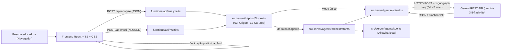
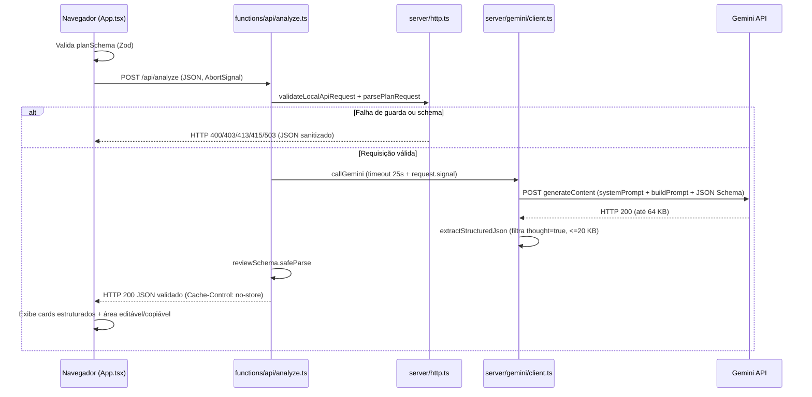
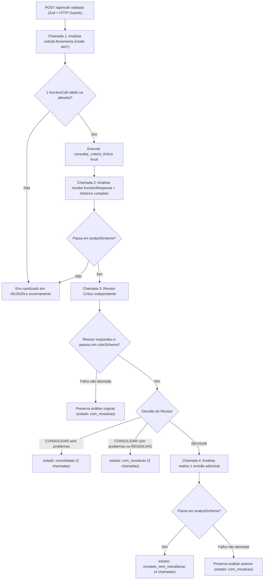
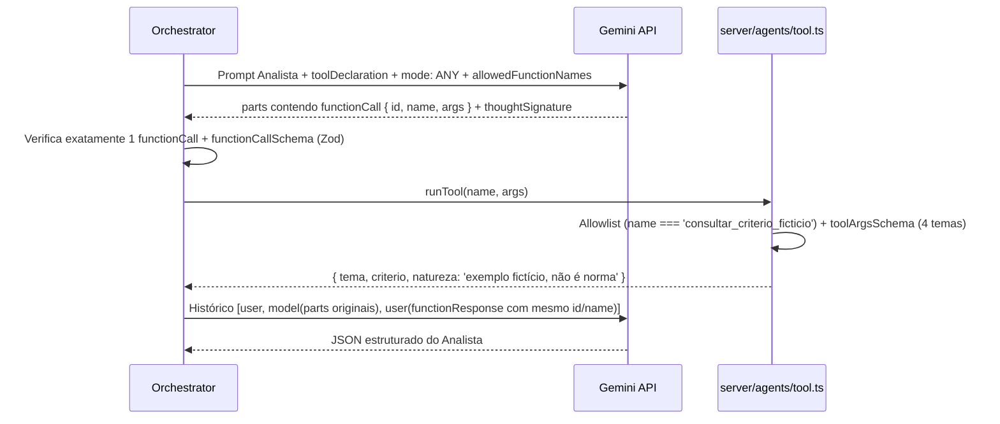
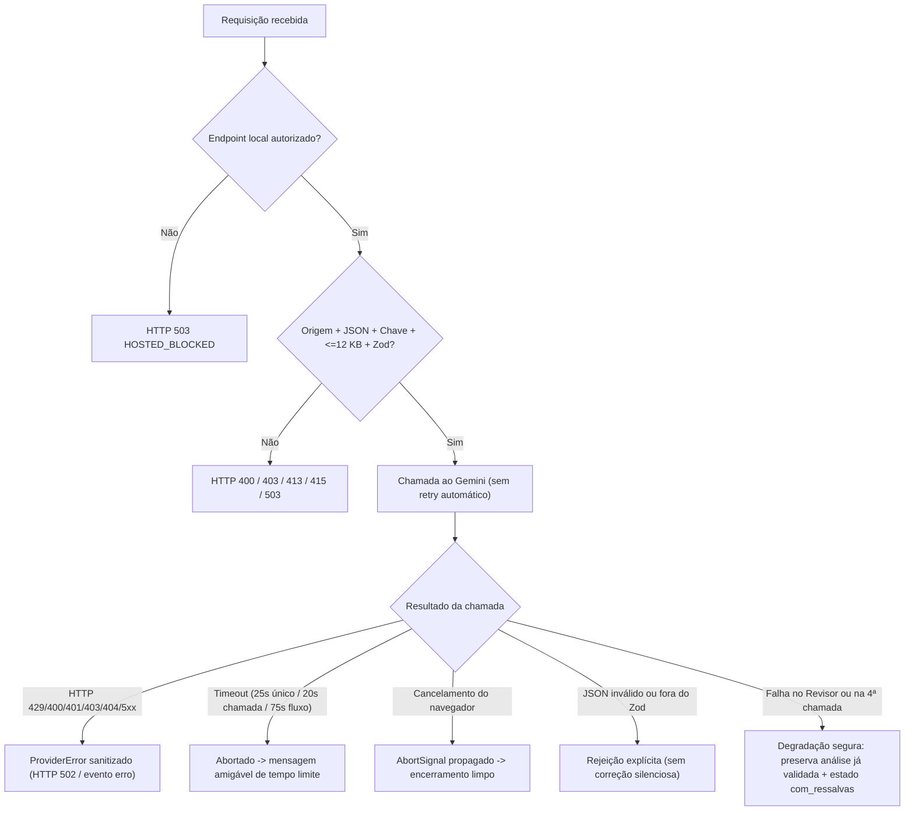

# Arquitetura do Sistema — AI Planning Reviewer V2

## 1. Visão Geral

O **AI Planning Reviewer V2** é um protótipo local de engenharia de aplicações com Large Language Models (LLMs) focado em apoiar a reflexão pedagógica sobre **planejamentos fictícios**. A arquitetura foi desenhada para ser simples, explícita, auditável e didática — sem frameworks de orquestração opacos (LangChain, LangGraph, CrewAI, etc.) e sem dependências de bancos de dados ou serviços externos além da API REST do Gemini.

A fronteira principal do sistema é a separação rigorosa entre:
- **Navegador (Frontend React + TypeScript + Vite + CSS):** coleta os dados fictícios, valida preliminarmente com Zod, controla cancelamento (`AbortController`), exibe etapas reais e permite revisar, editar e copiar o resultado. **Nunca recebe nem armazena `GEMINI_API_KEY`.**
- **Servidor (Cloudflare Pages Functions locais via Wrangler):** aplica controles HTTP (bloqueio de endpoints hospedados, mesma origem, `Content-Type`, limite de 12 KB), executa a validação definitiva com Zod, chama o cliente Gemini centralizado, coordena o fluxo multiagente + function calling e valida toda saída antes de devolvê-la ao navegador.

---

## 2. Organização por Responsabilidades

| Camada | Arquivos | Responsabilidade |
|---|---|---|
| **Schemas & Contratos** | `src/schemas/plan.ts`, `src/schemas/multi.ts` (+ re-exports em `src/schema.ts`, `src/multi-schema.ts`) | Contratos Zod de entrada, saída do provedor, analista, revisor, argumentos de ferramenta, eventos NDJSON e erros HTTP. |
| **Prompts Versionados** | `src/prompts/history.ts`, `src/prompts/single.ts`, `src/prompts/agents.ts` (+ `src/prompt.ts`) | Preservação das versões históricas V1–V3/multi-v1 e definições explícitas da V2 (`single-v4`, `multi-v2`). |
| **Hardening HTTP** | `src/server/http.ts` | Bloqueio de hospedagem (`503`), conferência de origem (`403`), `Content-Type` (`415`), leitura limitada a 12 KB (`413`), cabeçalhos de segurança. |
| **Cliente Gemini** | `src/server/gemini/client.ts` | Comunicação REST com `gemini-3.5-flash-lite`, limite de 64 KB na resposta, extração segura de JSON ignorando `thought: true`, mapeamento sanitizado de erros HTTP. |
| **Ferramenta Local** | `src/server/agents/tool.ts` | Allowlist estrita (`consultar_criterio_ficticio`) com 4 temas fixos e dados demonstrativos locais. |
| **Orquestrador** | `src/server/agents/orchestrator.ts` | Máquina de estados determinística (máximo 4 chamadas sequenciais), preservação de `id` e `thoughtSignature`, políticas de fallback e revisão única. |
| **Endpoints API** | `functions/api/analyze.ts`, `functions/api/multi.ts` | Pontos de entrada HTTP para agente único (JSON) e multiagente (streaming NDJSON). |
| **Frontend** | `src/main.tsx`, `src/components/PlanForm.tsx`, `src/components/ResultPanel.tsx`, `src/utils/formatReview.ts`, `src/data/examples.ts`, `src/style.css` | Interface acessível e responsiva, apresentação estruturada + área editável/copiável, rastreio real de execução. |
| **Preparação Futura** | `src/server/turnstile.ts` | Verificador Turnstile isolado (não conectado às rotas e não habilita hospedagem). |

---

## 3. Diagrama da Arquitetura Geral

---

## 4. Fluxo de Agente Único (`/api/analyze`)

---

## 5. Fluxo Multiagente (`/api/multi`)

---

## 6. Fluxo de Function Calling

---

## 7. Fluxo de Tratamento de Falhas

---

## 8. Decisões Arquiteturais Explícitas

1. **Zero retries automáticos:** repetir chamadas silenciosamente pode multiplicar consumo de cota/custo e mascarar falhas de schema ou rate limit (`429`).
2. **Teto rígido de 4 chamadas:** aplicado em duas camadas (`orchestrate` e `createGateway`), impedindo loops infinitos mesmo sob respostas anômalas do modelo.
3. **Validação estrita em vez de autocorreção silenciosa:** se o modelo devolver JSON malformado ou omitir campos obrigatórios, o backend rejeita a resposta em vez de "inventar" valores padrão que distorçam o significado.
4. **Honestidade de interface:** o modo agente único não finge progresso em etapas (porque é uma chamada única HTTP), enquanto o modo multiagente transmite eventos NDJSON reais à medida que cada etapa conclui no servidor.
