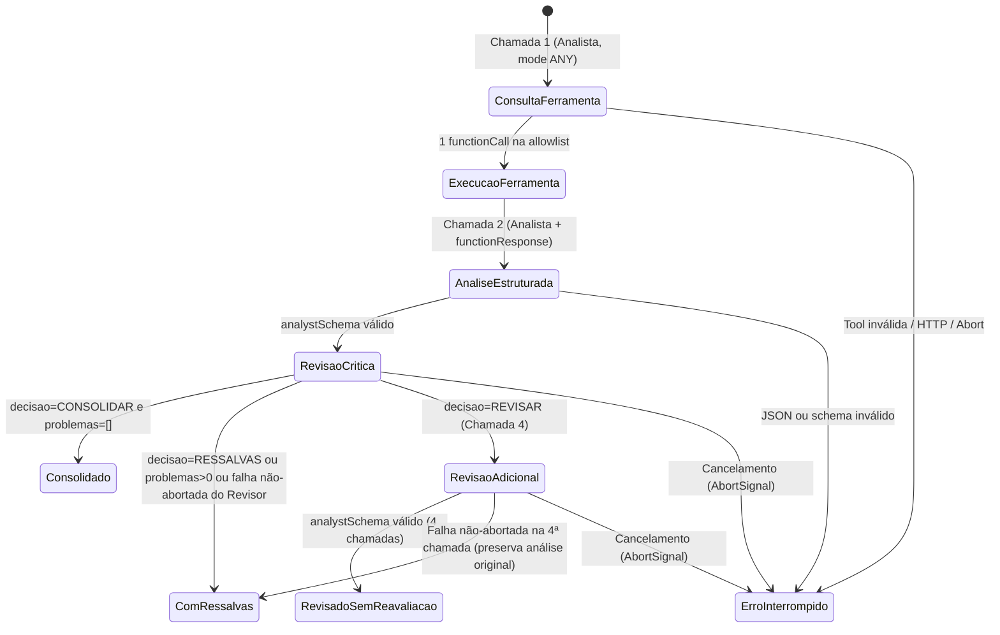

# Arquitetura Multiagente — AI Planning Reviewer V2

## 1. Princípio de Design

O modo multiagente **não** existe para aumentar artificialmente a complexidade nem utiliza frameworks pesados. Ele implementa dois papéis especializados de LLM (**Agente Analista** e **Agente Revisor Crítico**) coordenados por um **orquestrador determinístico em TypeScript** ([src/server/agents/orchestrator.ts](../src/server/agents/orchestrator.ts)).

Ambos os agentes utilizam o mesmo modelo base (`gemini-3.5-flash-lite`) com instruções de sistema, entradas e schemas Zod distintos.

---

## 2. Papéis e Responsabilidades

### 2.1. Agente Analista
- **Responsabilidade:** interpretar objetivos, avaliar coerência entre objetivos e atividades, investigar alinhamento da avaliação, apontar informações ausentes e propor sugestões específicas em JSON estruturado (`analystSchema`).
- **Separação obrigatória:** distingue `fatosInformados` (somente o que consta no texto) de `inferencias` (interpretações, lacunas e suposições não confirmadas).
- **Limitação explícita:** não aprova nem reprova planejamentos; toda saída precisa passar por validação Zod no servidor.

### 2.2. Agente Revisor Crítico
- **Responsabilidade:** examinar criticamente o par `{ planejamento, analise }` para identificar suposições não justificadas, fatos inventados, contradições, sugestões genéricas, problemas de alinhamento omitidos e limitações relevantes.
- **Postura ativa:** instruído explicitamente a **não concordar automaticamente** com o analista.
- **Saída (`criticSchema`):**
  - `decisao`: `'CONSOLIDAR' | 'REVISAR' | 'RESSALVAS'`
  - `problemas`: até 4 itens objetivos (`1..500` caracteres, sem espaços vazios)
  - `orientacao`: orientação curta para revisão (`0..800` caracteres)
- **Limitação explícita:** a decisão `CONSOLIDAR` do revisor **não é garantia de correção factual ou pedagógica** (conforme demonstrado no experimento real da V1 em `docs/historico/EXPERIMENTOS_AGENTES.md`, no qual o revisor consolidou uma resposta que ainda continha uma suposição sobre recursos da escola).

### 2.3. Orquestrador Determinístico
O orquestrador controla a máquina de estados sem delegar decisões de controle de fluxo ao LLM:
1. **Teto rígido de 4 chamadas:** aplicado simultaneamente no contador interno do `orchestrate` e no `createGateway`. Loops ilimitados são estruturalmente impossíveis.
2. **Sem retries automáticos:** falhas HTTP ou de timeout encerram a tentativa sem repetir silenciosamente.
3. **Cancelamento propagado:** `AbortSignal` combinado com timeout de 20s por chamada e 75s no fluxo total.

---

## 3. Estados Possíveis e Políticas de Transição

### Tabela de Diferenciação de Estados

| Estado final | Chamadas | Significado operacional |
|---|---|---|
| `consolidado` | 3 | Fluxo completo concluído; revisor escolheu `CONSOLIDAR` sem listar problemas. |
| `com_ressalvas` | 3 ou 4 | Concluído com ressalvas explícitas (decisão `RESSALVAS`, contradição `CONSOLIDAR` + `problemas`, indisponibilidade do revisor ou falha da 4ª chamada preservando a análise original validada). |
| `revisado_sem_reavaliacao` | 4 | O revisor solicitou `REVISAR`, o analista reescreveu uma única vez e **essa nova versão não foi reavaliada automaticamente** para preservar o limite máximo de 4 chamadas. |
| Execução interrompida / falha | 0 a 4 | Cancelamento pelo usuário, timeout, falha inicial do analista, ferramenta inválida ou falha de validação estrutural: nenhum resultado parcial não validado é entregue. |

---

## 4. Política da Revisão Adicional (4ª Chamada)

Quando o revisor escolhe `REVISAR`, o orquestrador permite **no máximo uma** reescrita pelo analista. Essa escolha preserva explicitamente o limite de 4 chamadas por execução (1 ferramenta + 1 análise + 1 revisão + 1 reescrita). Como consequência:
- A versão revisada **não passa por nova rodada do revisor crítico**;
- O backend marca obrigatoriamente `estado: 'revisado_sem_reavaliacao'` e adiciona a ressalva `'A versão revisada não passou por nova revisão automática.'`;
- Se a 4ª chamada falhar (exceto por cancelamento), o orquestrador faz degradação segura mantendo a análise anterior (já validada por `analystSchema`) com `estado: 'com_ressalvas'`.

---

## 5. Observabilidade Sem Exposição de Raciocínio Interno

Os eventos transmitidos em NDJSON (`functions/api/multi.ts`) são exclusivamente rótulos operacionais verificáveis:
- `Analista: consulta de critério`
- `Ferramenta local: critério fictício consultado (<tema>)`
- `Analista: análise estruturada`
- `Revisor: conferência crítica`
- `Orquestrador: solicitada uma revisão` *(somente se realmente ocorreu)*
- `Revisor indisponível: resultado com ressalva` *(somente se realmente ocorreu)*
- `Orquestrador: resultado consolidado`

Nenhuma etapa é anunciada antes de ocorrer ou simulada falsamente, e partes marcadas pelo provedor com `thought: true` são descartadas em `extractStructuredJson`.
